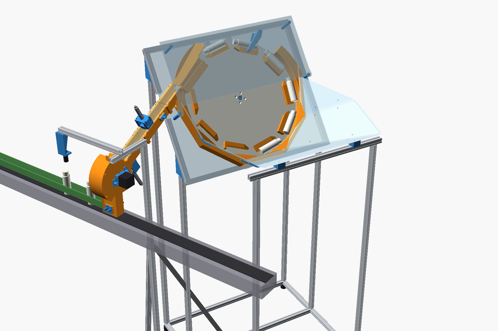
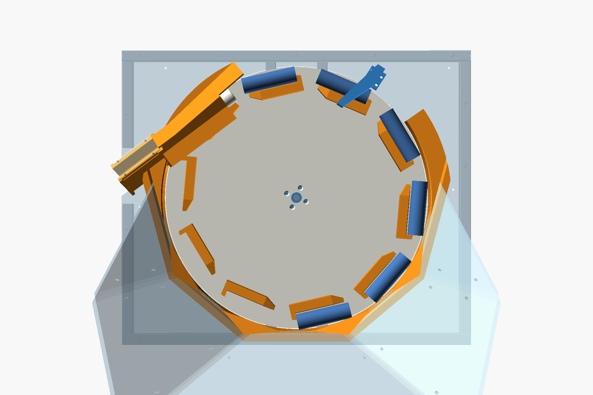
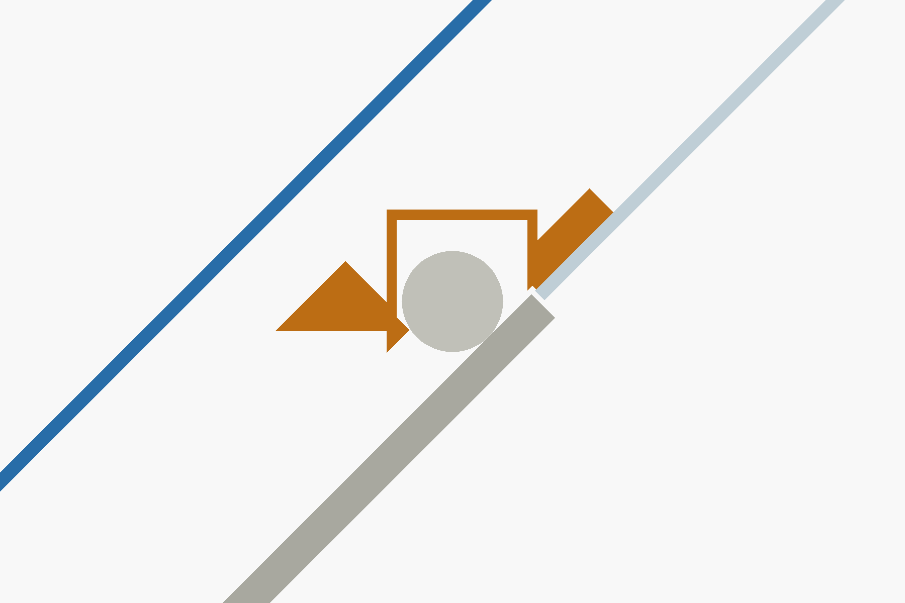
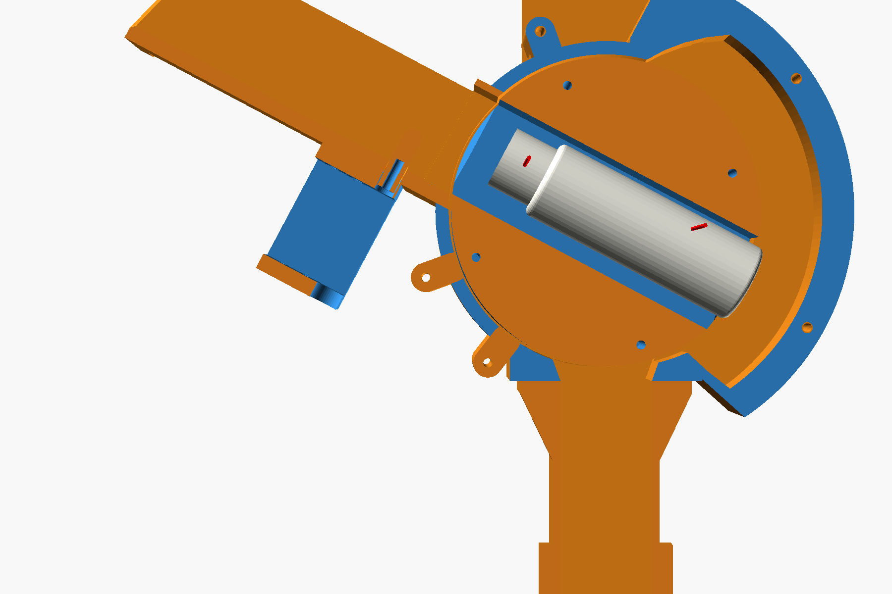
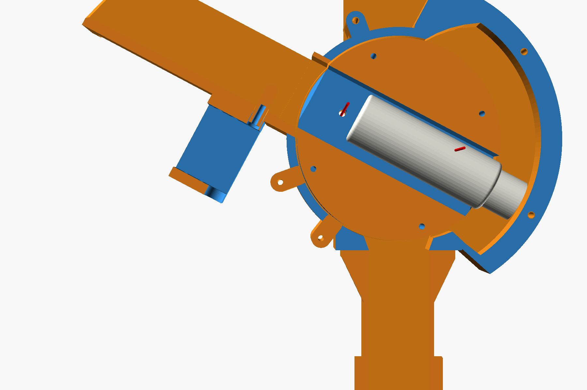
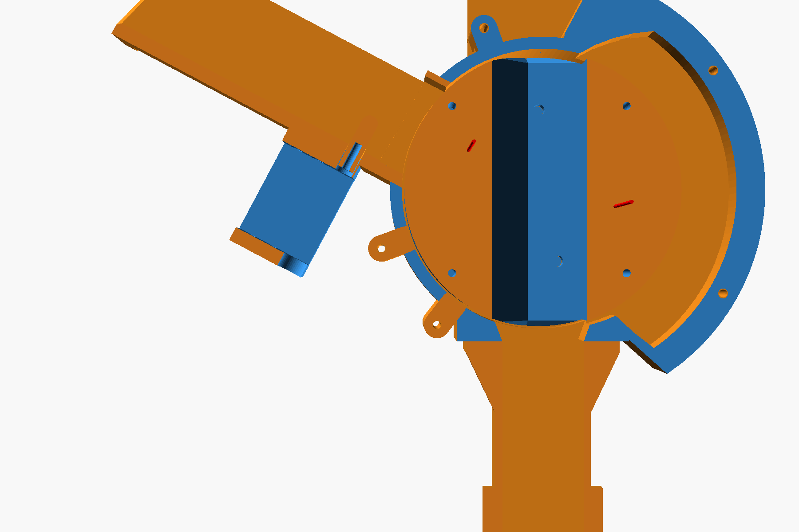
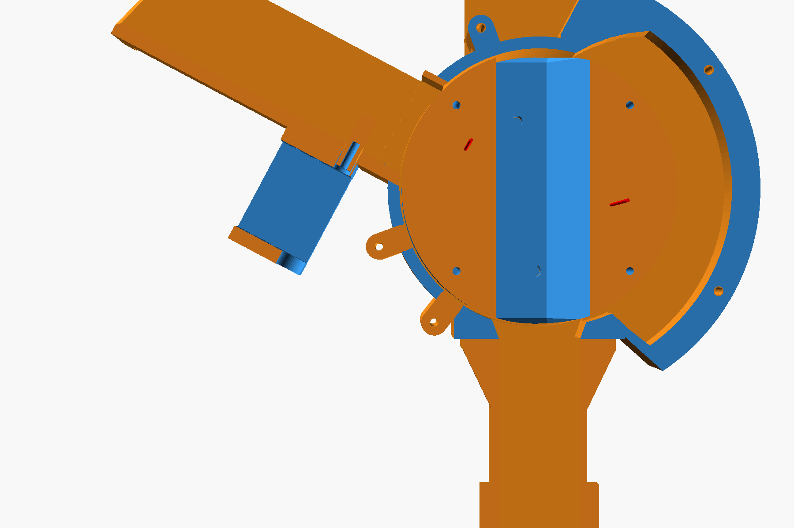
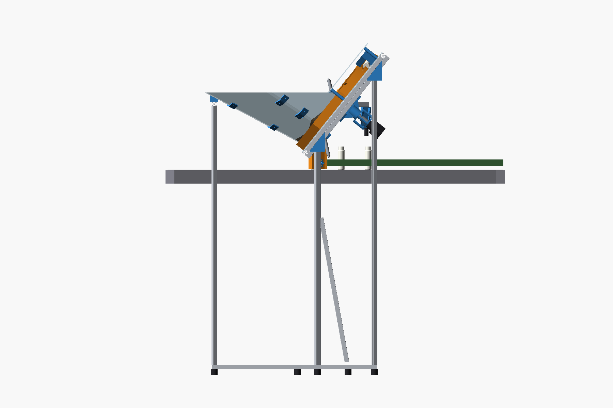

# Flaschen-Unscrambler für das KE-50 Band – Konzept

**Flasche:** Rebhan FPS K-3906.004, 50 ml HD-PE, Ø30 ± 0,3 × 102,5 ± 1 mm, Hals 24/410 (Ø23,8), 7 g
**Ziel:** Flaschen aus dem Karton (≈ 500 Stück, lose) **stehend, Boden unten** einzeln aufs KE-50 Band, 30–60 Fl./min
**Randbedingungen:** keine Vibrationstonne, Gestell aus 20×20 Nut 6 B-Typ, Funktionsteile aus dem 3D-Drucker (PETG, Bauraum 256 mm), Druckluft vorhanden, Steuerung ESP32 + Schrittmotoren



## 1. Funktionsprinzip

```
 Bunker ─► Hakenteller ─► Übergabe ─► Rinne (28°) ─► Klemme B ─► Sperre A ─► Wendetrommel ─► Fallschacht ─► Band
 (≈260 Fl.) D500, 10 Haken  Pflug, T    V-Rinne      (X3 halten)  (X2 halten)  Halsnut +        Boden voraus
            51° geneigt                 "voll" X4                              2 Lichtschranken
```

1. **Bunker + Hakenteller** (ohne Vibration):
   - Ein Teller Ø500 aus PE-HD dreht schräg (51,4° gegen die Waagerechte) mit 15 U/min.
   - Zehn gedruckte **Haken** sitzen auf dem Rand. Jeder Haken ist eine Tasche aus Leiste (innen) und Mitnehmer (hinten), genau eine Flasche lang.
   - Unten läuft der Teller durch das Schüttgut. Eine Flasche, die quer zur Tasche liegt, fällt in die Tasche und wird mitgenommen.
   - Auf der steigenden Seite hält der **Randring** die Flasche in der Tasche. Oben drückt die Schwerkraft sie gegen die Leiste.
   - Der **Abstreifer** wirft eine zweite Lage (Flasche auf Flasche) zurück in den Bunker.
   - Der Bunker ist ein Trichter aus fünf ebenen Platten (Boden 28°, Seiten 39° und 63°, alle Kehlen ≥ 26°). Die Platten stehen in Nuten des Randrings. So gibt es keine toten Ecken, alles rutscht zum Teller.
2. **Übergabe T** (37° hinter dem höchsten Punkt des Tellers):
   - Die Tellerfläche ist dort genau die eine Flanke der 90°-V-Rinne, die Hakenleiste die andere.
   - Die Flaschenachse zeigt dort exakt in Rinnenrichtung (28° Gefälle). Die Flasche rutscht tangential aus der Tasche in die Rinne.
   - Ein feststehender **Pflug** über den Haken (Unterkante 1 mm über den 17 mm hohen Haken) setzt die Leiste fort. Die Haken tauchen darunter weg.
   - Eingang, Seitenwand und Dach sind aufgeweitet, falls eine Flasche schon vor T in der Tasche vorrutscht (geringe Reibung).

   | Teller von vorn | Schnitt durch die Übergabe |
   |---|---|
   |  |  |

   Im Schnitt (Blick entlang der Rinne) sieht man:
   - die Flasche auf der Tellerfläche (graue Diagonale)
   - links den Pflug oberhalb der Haken, rechts die Seitenwand und darüber das Dach
   - den Fuß der Übergabe auf der Rückwand
   - die Haube darüber (blau)
3. **Vereinzelung:** Die Flaschen liegen Stoß an Stoß in der Rinne.
   - **Klemme B** (Ø10/10, 1–2 bar, TPU-Pad) hält die dritte Flasche (X3) fest.
   - **Sperre A** (Ø10/25, Stift von unten) gibt genau eine Flasche (X2) frei und schließt sofort dahinter.
   - Danach öffnet B, die Reihe rutscht um eine Flaschenlänge nach, und B klemmt wieder.
   - Die Lichtschranke **„Rinne voll“** an X4 schaltet den Teller ab. Der Abstand T → X5 ist so gewählt, dass die Mitnehmer an der wartenden Reihe vorbeistreichen (siehe 5.).
4. **Wendetrommel mit Halsnut (Kern der Orientierung):** Die Flasche rutscht in den Trommelschacht bis an den Gehäuseanschlag.
   - Dort ist eine **26,5 mm breite Umfangsnut** eingelassen.
   - Der **Hals (Ø23,8) taucht ≈ 17 mm** in die Nut ein. Der **Rumpf (Ø30)** passt nicht hinein.
   - Dadurch liegt das Einlaufende je nach Lage ≈ 17 mm verschieden. Eine Lichtschranke dort unterscheidet sicher, mit ± 8,7 mm Reserve:

   | Lichtschranke „Orientierung“ | Lage | Drehung | Ergebnis |
   |---|---|---|---|
   | **belegt** | Boden am Anschlag | **−62°**: Anschlagende nach unten | Boden voraus in den Schacht |
   | **frei** | Hals in der Nut | **+58°** halten (Hals rutscht aus der Nut), dann **+118°**: Einlaufende nach unten | Boden voraus in den Schacht |

   Eine zweite Lichtschranke („Präsenz“) bestätigt, dass eine Flasche da ist. Ist das Ergebnis unklar, wackelt der Rotor kurz (−6°) und misst neu.
5. **Fallschacht → Band:**
   - Die Flasche fällt ≈ 113 mm Boden voraus durch einen Trichter in den Schacht. Er ist 34 mm breit, an drei Seiten geführt und zum Band hin (+X) offen.
   - Die Flasche steht auf dem Gurt und wird ausgetragen.
   - Zwei Lichtschranken im Schacht melden „frei“, der E18-Sensor über dem Band erkennt einen Stau.

| Boden am Anschlag | Hals in der Nut |
|---|---|
|  |  |
| Abwurf −62° | Abwurf +118° |
|  |  |

## 2. Warum diese Lösung

- **Hakenteller statt Vibration:**
  - Leise, schont die Flaschen, robust.
  - Nur ein Motor, kein Feinabgleich.
  - Die Tasche nimmt nur liegende Flaschen in Längsrichtung auf. Damit liegt die Flasche schon in Rinnenrichtung, es bleibt nur „Hals vorn oder hinten“.
  - Die Teller-Neigung ergibt sich zwangsläufig aus der Rinne: Die Tellerfläche ist eine Flanke des 90°-V. Deshalb gibt es an der Übergabe keinen Absatz.
- **Orientierung über Geometrie, nicht über Gewicht:**
  - Boden und Hals wiegen bei der leeren Flasche praktisch gleich viel, Fallrichtungs-Tricks sind deshalb unzuverlässig.
  - Die Halsnut macht aus 3 mm Durchmesserunterschied **17 mm Lageunterschied**. Damit reichen einfache Lichtschranken, auch bei L ±1 und D ±0,3.
- **Ein Motor für alle Lagen:** Beide Lagen werden durch die Drehrichtung gelöst. Es gibt keinen Ausschuss und keine Rückführung, also 100 % Ausbeute.
- **Fail-safe:**
  - Stromlos ist die Sperre zu und die Klemme offen. Der Rotor steht dann, und es kann nichts nachlaufen.
  - Läuft ein Mitnehmer gegen eine Flasche, blockiert nur der Schrittmotor (≈ 13 N an der Flasche). Die Firmware erkennt das am Hall-Takt.

## 3. Hauptmaße (Band-OK = 900 mm, Parameter `BELT_Z`)

| Größe | Wert |
|---|---|
| Rotorachse über Boden | 1072 mm (Band + 172) |
| Tellermitte über Boden | 1197 mm, Teller unten 1002 / oben 1392 mm |
| Bunkerrand (Füllhöhe) | **1240 mm (Band + 340)**, waagerecht |
| Bunkerinhalt | ≈ 34 l ≈ **260 Flaschen** (ein Karton in zwei Portionen) |
| Teller | Ø500 × 10 PE-HD, 10 Haken, Bahnradius 228,7, 15 U/min, Neigung 51,4° |
| Rinne | 90°-V, lichte Breite 33, Decke +18,5 über Flaschenachse, Neigung 28° |
| Wendetrommel | Ø116 × 45, Gehäuse Ø118 innen, Halsnut 26,5 breit / 22 tief |
| Fallhöhe | max. 113 mm (1,5 m/s) |
| Platzbedarf | ca. 0,95 m × 0,95 m neben dem Band (Y −980 … −80), Höhe ≈ 1,46 m; Arm reicht 45 mm über die Bandmitte |

Alle Maße sind parametrisch in [`cad/config.scad`](../cad/config.scad). Die **Bandhöhe** bitte vor Ort messen und `BELT_Z` anpassen. Danach `tools/build_all.sh` ausführen; Profillängen, Platten und STL passen sich an.



**Warum der Bunker nicht größer ist:** Der Auslauf vom Teller zur Rinne läuft links über die Bunkerecke. Bei Füllhöhe Band + 340 bleiben 8 mm Abstand zwischen Schüttgut und Auslauf.

Mehr Inhalt ginge nur mit einem zweiten Vorratsbunker mit eigener Klappe, oder mit einem größeren Teller, z.B. Ø600 (`TD_R`, `TD_RB`). Bei 60 Fl./min reicht eine Füllung gut 4 Minuten.

## 4. Leistung (aus [`auslegung.md`](auslegung.md))

- **Rinne:** Im 90°-V reiben beide Flanken, die Flasche rutscht bis µ < 0,376. PE-HD auf PETG liegt trocken bei µ ≈ 0,15–0,30.
- **Takt:** Wendetrommel + Vereinzelung brauchen bei µ = 0,2 ≈ 0,89 s (Boden am Anschlag) bzw. ≈ 0,98 s (Hals am Anschlag). Im Mittel sind das **≈ 64 Fl./min**. Begrenzend ist das Nachrutschen der Warteschlange.
- **Teller:** 150 Taschen/min. Für 64 Fl./min reicht es, wenn 43 % der Taschen gefüllt sind. Ist die Rinne voll (X4), stoppt der Teller nach 120 ms Entprellung und 150 ms Rampe, bevor die übernächste Tasche T erreicht. Dafür ist ≈ 410 ms Zeit.
- **Tellerantrieb:** Abgeschätzt ≈ 1,8 Nm. Ein NEMA17 mit Planetengetriebe 13,73:1 (≈ 206 U/min am Motor) liefert ≈ 3 Nm (Getriebegrenze).

## 5. Prüfungen am CAD-Modell (automatisch, `tools/`)

| Prüfung | Ergebnis |
|---|---|
| Kollision: 155 Paarungen über 12 Tellerwinkel (eine Hakenteilung) und 10 Rotorwinkel, mit Taschenflaschen und Warteschlange X1…X5 | **0 Kollisionen** |
| Mitnehmer streicht an der hintersten wartenden Flasche X5 vorbei (L +1 mm je Flasche) | frei (Mitnehmer bis s = −499, X5 endet bei −494,5) |
| Taschenflasche (L 103,5 / D 30,3, beide Richtungen) vom Tellergrund bis T, an Leiste und am Randring | frei (106 Lagen) |
| Übergabe: Flasche rutscht vor T bis 32 mm in der Tasche vor | frei |
| Durchlauf Übergabe → Auslauf → G1 → G2 → Rotor (Sperre und Klemme offen) | frei |
| Lichtschranken bei L 101,5/102,5/103,5 und D 29,7/30/30,3 (je beide Lagen) | **alle eindeutig** |
| Abwurf −62° / +118°, freier Fall, Auslauf unter dem Gehäuse | frei |
| Bunker: Füllraum, Abstand zum Auslauf | 34 l, 8 mm |
| Druckteile: dicht, ein Körper, passt in 256 mm | 36 Teile (66 Stück) ok |

## 6. Offene Punkte vor Ort

1. **Bandhöhe KE-50 messen** → `BELT_Z`. Prüfen, ob die Bandbeine im Bereich Y = −80 … −980 mm neben der Abwurfstelle frei sind (Bodenrahmen, Rotorfuß bei Y ≈ −90).
2. **Seitenführung des KE-50** auf X = −30…+50 mm um die Abwurfstelle aussparen. Die Seitenwände des Fallschachts übernehmen dort die Führung und laufen bei X = +50 aus. Die Führungen auf **34 mm** Abstand einstellen. Bandgeschwindigkeit ≥ 0,15 m/s.
3. **Getriebeflansch** des Tellermotors prüfen. Angenommen sind 4 × M4 auf Ø28 mit Zentrierung Ø22 (`GB_PCD` in `cad/parts/teller.scad`).
4. **Tellerplatte:** PE-HD 10 mm muss eben sein (Planlauf am Rand ≤ 1 mm). Die Haken laufen 1 mm unter dem Pflug durch. Notfalls `PLOW_Z0` erhöhen.
5. **Reibung:** Bei sehr rauen oder klebrigen Flaschen (µ > 0,3) rutscht die Rinne langsam. Dann `ALPHA` erhöhen (Rinne und Teller drehen sich mit) oder die Gleitflächen glätten.
6. **Naturfarbene, durchscheinende Flaschen:** Die Lichtschranken arbeiten analog mit einstellbarer Schwelle. Der Befehl `cal` misst den freien Pegel. Bei sehr klaren Flaschen kann ein Polarisationsfilter oder ein IR-Laser nötig sein.
