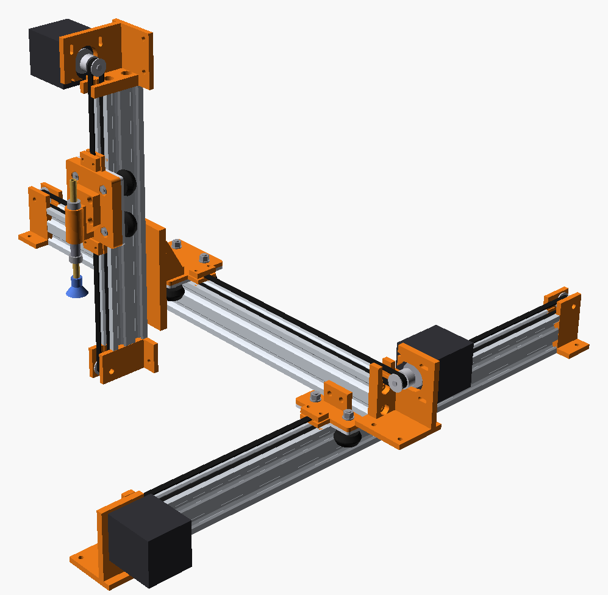
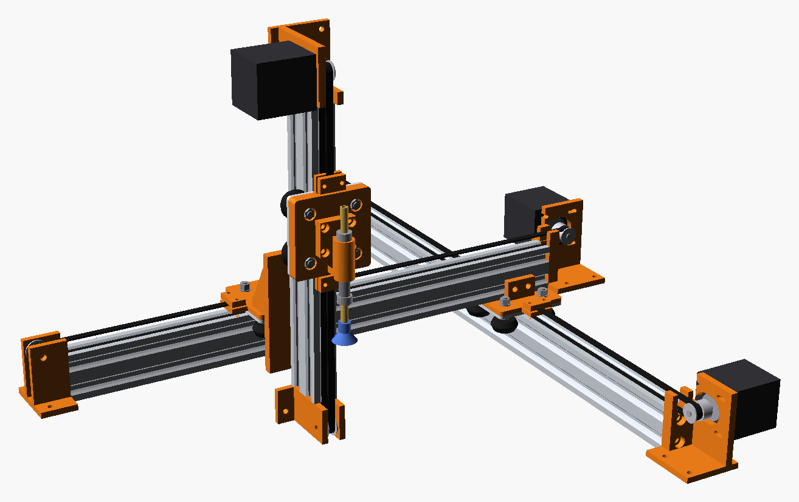
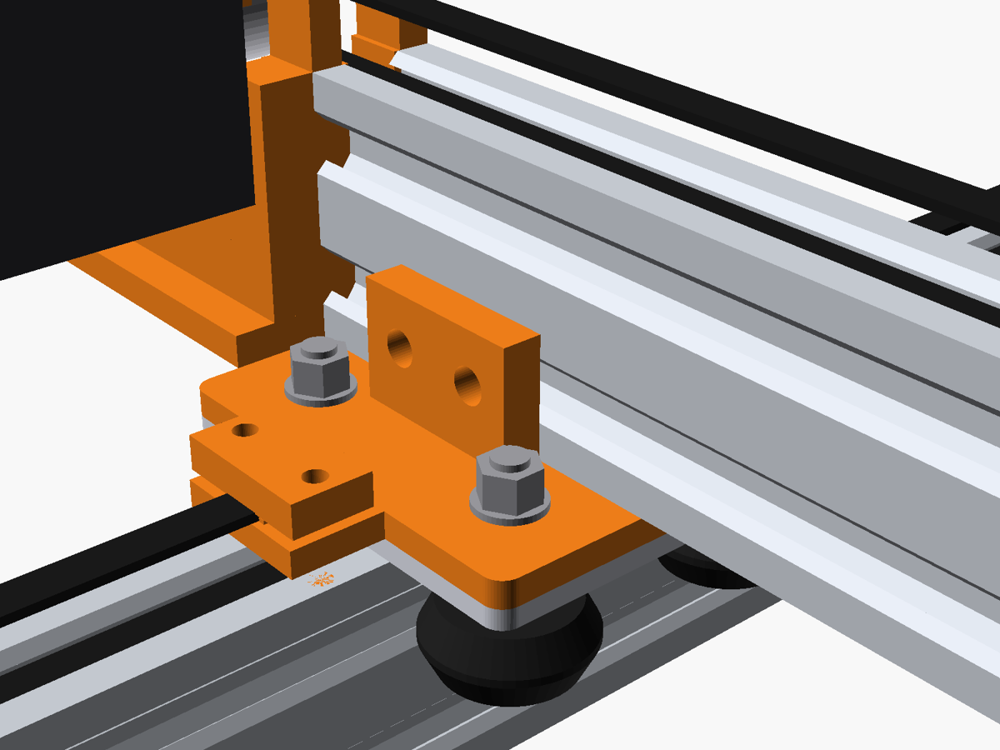
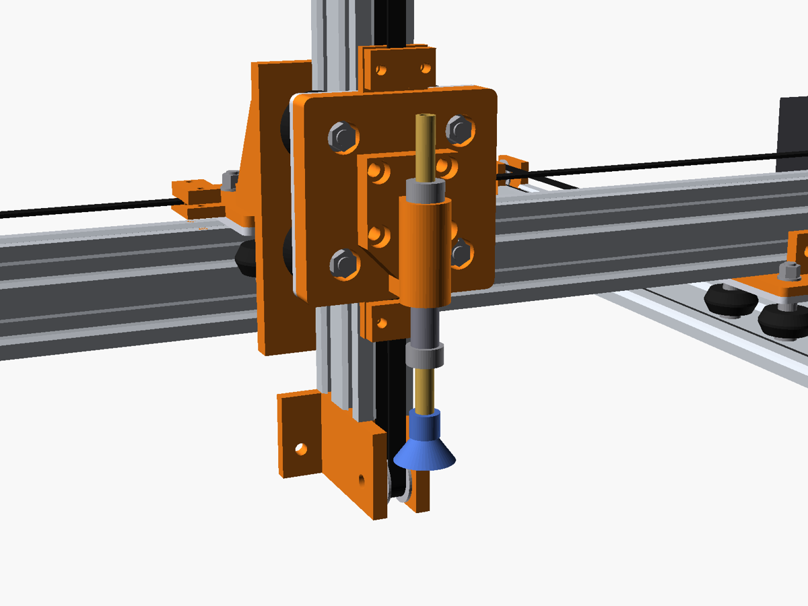
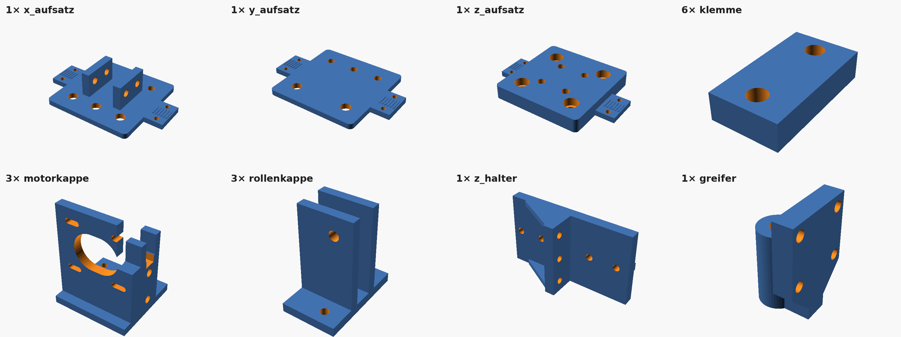

# Einfaches 3-Achs-Gantry mit Vakuumgreifer

Kartesische Maschine in Auslegerbauweise. Jede Achse besteht aus einem
V-Slot-Profil 2040, einer Alu-Schlittenplatte 65,5 × 65,5 mm mit vier V-Rädern,
einem NEMA17-Motor und einem GT2-Riemen. Es gibt keine Gewindespindel. Am Z-Schlitten sitzt ein federnder Vakuumgreifer.
Gedacht für Pick & Place, Sortieren und Umsetzen kleiner Teile. Mit anderem
Werkzeug geht auch Plotten oder Lasern.




## Aufbau

Die Schlittenplatte hat 39,7 mm Radabstand quer und passt damit auf die
**20-mm-Seite** des 2040-Profils. Alle drei Profile stehen deshalb hochkant: Die
Platte liegt auf der schmalen Seite, die Räder laufen in den Nuten der breiten
Seiten.

| Achse | Profil | Lage | Antrieb |
|---|---|---|---|
| X | 2040 × 500 mm | steht hochkant auf dem Grundbrett | GT2-Riemen 6 mm |
| Y | 2040 × 450 mm | Ausleger, hochkant quer auf dem X-Schlitten | GT2-Riemen 6 mm |
| Z | 2040 × 250 mm | senkrecht am Y-Schlitten (Z-Halter) | GT2-Riemen 6 mm, Motor oben |

- Auf jede Alu-Platte kommt ein gedruckter **Aufsatz**. Er wird mit den
  Radschrauben festgeklemmt und trägt die Riemenklemmen, beim X-Schlitten
  zusätzlich die Wiege für den Y-Ausleger und beim Z-Schlitten den Greifer.
- Alle drei Achsen sind gleich angetrieben, mit denselben Endkappen. Der Riemen
  läuft als Schlaufe: Ein Trum liegt in der Profilnut unter dem Schlitten, das
  andere läuft über der Platte und ist an beiden Enden des Aufsatzes geklemmt.
  Gespannt wird über Langlöcher in der Motorkappe. Bei Z sitzt die Motorkappe
  oben und die Rollenkappe unten.



### Kennwerte (Standardmaße)

| | Wert |
|---|---|
| Verfahrweg X | 406 mm |
| Verfahrweg Y | 310 mm (siehe [Grenzen](#grenzen-und-softlimits)) |
| Verfahrweg Z | 156 mm |
| Saugnapf | 113 mm neben der X-Schlittenmitte (in −X) |
| Saugnapf bei tiefstem Z | 1,3 mm unter der Tischfläche, die Feder gleicht das aus |

OpenSCAD gibt diese Werte beim Rendern als `ECHO` aus. Sie passen sich an,
wenn Profillängen geändert werden.

## Vakuumgreifer



Ein Messingrohr 6 × 1 mm gleitet in einer gedruckten Führungshülse und ist
zugleich der Luftkanal. Unten sitzt der Saugnapf, oben geht der Schlauch zur
Pumpe. Eine Druckfeder zwischen Hülse und unterem Stellring drückt das Rohr nach
unten, der obere Stellring begrenzt den Weg. Setzt der Saugnapf auf, federt das
Rohr bis ca. 8 mm ein. So muss die Z-Höhe nicht genau stimmen und der Napf liegt
immer mit Druck auf.

- **Pumpe:** 12-V-Mini-Membranpumpe für Vakuum (ca. −60 kPa).
- **Ventil:** 12-V-Magnetventil 2/2 stromlos geschlossen als Belüftung, per
  T-Stück in die Leitung. Nach dem Ablegen öffnet es kurz, damit das Teil sofort
  loskommt.
- **Ansteuerung mit GRBL:** Pumpe über MOSFET-Modul an den Kühlmittel-Ausgang
  (`M8` an, `M9` aus), Ventil an den Nebel-Ausgang (`M7`, muss in GRBL
  freigeschaltet sein). Beide Spulen brauchen eine Freilaufdiode.
- **Haltekraft:** Mit Ø 20 mm Napf bei glatter Oberfläche bis etwa 200 g sicher.

Ablauf in G-Code:

```
G0 Z20            ; über das Teil (Z0 = Oberkante Teil)
G1 Z-1 F600       ; aufsetzen, Feder federt ein
M8                ; Pumpe an
G4 P0.5           ; Vakuum aufbauen
G0 Z20            ; anheben, verfahren, absetzen ...
M9                ; Pumpe aus
M7                ; Belüftung auf
G4 P0.3
M9                ; Belüftung zu
G0 Z20
```

## Dateien

- `gantry.scad`: parametrisches OpenSCAD-Modell. Mit `teil = "baugruppe"` zeigt es
  die ganze Maschine (F5). `pos_x`, `pos_y` und `pos_z` verfahren die Schlitten.
  Jedes andere `teil` rendert ein einzelnes Druckteil, schon in Druckrichtung auf z = 0.
- `stl/`: alle Druckteile mit den Standardwerten gerendert
- `bilder/`: Ansichten

## Druckteile



| Teil | Anzahl | Funktion |
|---|---|---|
| `x_aufsatz` | 1 | auf der X-Platte: 2 Riemenklemmen, Wiege für den Y-Ausleger |
| `y_aufsatz` | 1 | auf der Y-Platte: 2 Riemenklemmen, Bohrung für den Z-Halter |
| `z_aufsatz` | 1 | auf der Z-Platte: 2 Riemenklemmen, 4 Gewindeeinsätze für den Greifer |
| `klemme` | 6 | Deckel der Riemenklemmen |
| `motorkappe` | 3 | Profilanfang (bei Z oben), Motor liegend mit Langlöchern zum Spannen |
| `rollenkappe` | 3 | Profilende (bei Z unten), Umlenkrolle zwischen zwei Wangen |
| `z_halter` | 1 | Winkel auf dem Y-Aufsatz, hält das Z-Profil an der Rückseite (mit Nutfeder) |
| `greifer` | 1 | Halter mit Führungshülse für das Saugrohr |

Die Füße an Motor- und Rollenkappe braucht nur die X-Achse zum Festschrauben,
bei Y und Z stören sie nicht.

Druckempfehlung: PETG oder ASA, 0,2 mm Schicht, 4 Wände, 40 % Infill (Gyroid),
Aufsätze mit 60 % Infill. Die STLs liegen schon richtig herum, Stützen sind
nicht nötig. Den Greifer stehend drucken (liegt so in der STL), damit die
Führungsbohrung rund wird. Falls das Rohr klemmt, die Bohrung mit einem
6,3-mm-Bohrer nacharbeiten.

## Stückliste (Zukaufteile)

**Mechanik**
- V-Slot 2040: 500 mm, 450 mm, 250 mm, an allen 6 Enden M5-Gewinde in die
  Kernlöcher geschnitten
- 3 × Alu-Schlittenplatte 65,5 × 65,5 × 3 mm (die aus der Zeichnung)
- 12 × V-Rad (Solid V-Wheel, Delrin) mit 2 × 625ZZ
- 6 × Distanzhülse 6,35 mm, 6 × Exzenterbuchse 6,35 mm (gehören oft zum Plattensatz)
- 3 × NEMA17 (z. B. 17HS4401, Welle 5 mm, mind. 20 mm lang)
- 3 × GT2-Zahnscheibe 20 Zähne, Bohrung 5 mm, für 6-mm-Riemen
- 3 × GT2-Umlenkrolle 20 Zähne verzahnt, Bohrung 5 mm (Ø 18 mm, ca. 8,5 mm breit)
- GT2-Riemen 6 mm, 3 m (X ≈ 1060 mm, Y ≈ 960 mm, Z ≈ 560 mm)

**Vakuumgreifer**
- Messingrohr 6 × 1 mm, 100 mm lang
- 2 × Stellring 6 mm (DIN 705)
- Druckfeder Innen-Ø ≥ 6,5 mm, Außen-Ø ≤ 10 mm, ca. 20 mm lang (z. B. 0,6 × 9 × 20)
- Silikon-Saugnapf Ø 15–20 mm mit Anschluss für 6-mm-Rohr bzw. -Schlauch
- Silikonschlauch 5 mm innen, ca. 1,5 m, T-Stück
- 12-V-Vakuumpumpe, 12-V-Magnetventil 2/2 NC, 2 MOSFET-Module, 2 Freilaufdioden

**Schrauben**
- Räder: 10 × M5×30 und 2 × M5×40 Linsenkopf (ISO 7380), je mit Scheibe und
  Stoppmutter. Die beiden M5×40 sitzen am Y-Schlitten auf der Z-Seite und
  klemmen den Z-Halter mit.
- Profilenden: 12 × M5×16 Zylinderkopf
- Y-Ausleger: 2 × M5×12 von unten durch Platte und X-Aufsatz, 4 × M5×10 durch
  die Wiege, dazu 6 × Hammermutter M5 (V-Slot/Nut 6)
- Z-Halter: 1 × M5×20 + Mutter (Flansch), 4 × M5×14 + 4 × Hammermutter (Wand)
- Umlenkrollen: 3 × M5×25 + Mutter + 6 × Scheibe
- Motoren: 12 × M3×10 mit Scheibe
- Riemenklemmen: 12 × M3×12 + 12 × Mutter M3
- Greifer: 4 × M4×10 + 4 × Gewindeeinsatz M4 (Bohrung 5,6 mm, im Z-Aufsatz)
- Grundbrett: 4 × Holzschraube 4 mm durch die Füße der X-Kappen, dazu 2 × M5 +
  Hammermutter in die untere Nut des X-Profils

**Elektronik (Vorschlag)**
- Arduino Uno + CNC-Shield mit GRBL oder ein Board mit FluidNC
- 3 × Treiber TMC2209 oder A4988, Netzteil 12 V (Pumpe und Ventil laufen mit)
- 3 × Endschalter
- Schritte/mm bei 1/16-Mikroschritt: X, Y und Z = 80
- In GRBL `$1=255` setzen, damit die Motoren dauerhaft bestromt bleiben und Z
  im Stillstand hält (siehe [Grenzen](#grenzen-und-softlimits))

## Montage

1. **Räder.** Linsenkopfschraube von der Radseite durch Rad, Hülse und
   Alu-Platte stecken. Auf der Exzenterseite (Bohrungen Ø 7,2) kommt die
   Exzenterbuchse, gegenüber die normale Hülse. Den Aufsatz darüberlegen, Scheibe
   und Stoppmutter oben aufsetzen, noch nicht fest anziehen. Am Y-Schlitten auf
   der Z-Seite (ohne Exzenter) gleich die M5×40 nehmen, dort kommt später der
   Flansch des Z-Halters unter die Mutter.
2. **Klemmmuttern.** Die M3-Muttern von unten in die Sechskanttaschen der
   Klemmzungen drücken. Sie stehen 1,4 mm unter der Zunge vor, das ist so gewollt.
3. **Y-Ausleger auf den X-Schlitten.** Zwei Hammermuttern in die untere Nut und
   je zwei in die unteren Seitennuten des Y-Profils schieben. Das Y-Profil in die
   Wiege setzen, das Ende bündig mit der Plattenkante. Mit 2 × M5×12 von unten
   durch Platte und Aufsatz sowie 4 × M5×10 durch die Wiege verschrauben. Die
   beiden unteren Schrauben sitzen neben dem X-Profil zwischen den Rädern und sind
   von unten erreichbar.
4. **Schlitten aufschieben.** Alle drei Schlitten von den Profilenden her
   aufschieben. Die Exzenter so drehen, dass kein Spiel bleibt und der Schlitten
   noch leicht läuft. Dann die Radmuttern festziehen. Ein Rad, das du mit zwei
   Fingern nicht mehr drehen kannst, ist zu fest.
5. **Endkappen.** Motor mit 4 × M3×10 an die Motorkappe schrauben, die Zahnscheibe
   mittig über dem Profil ausrichten (nabenfernes Ende 4,5 mm neben der
   Profilmitte). Kappen mit 2 × M5×16 in die Profilenden schrauben, der Schlüssel
   geht von der offenen Stirnseite hinein. Die Umlenkrolle mit zwei Scheiben auf
   der M5×25 zwischen die Wangen der Rollenkappe setzen.
6. **Riemen.** Das untere Trum flach in die obere Profilnut schieben (Zähne nach
   oben), um Rolle und Zahnscheibe legen und beide Enden in die Klemmen an den
   Enden des Aufsatzes legen, Zähne nach unten auf die Rippen. Klemmdeckel mit
   2 × M3×12 festziehen. Zum Spannen die vier Motorschrauben lösen, den Motor in
   den Langlöchern nach außen ziehen (bis 6 mm) und wieder festziehen.
7. **Z-Achse.** Wie X und Y aufbauen: Schlitten aufschieben, Motorkappe oben,
   Rollenkappe unten, Riemen einlegen und spannen. Vorher vier Hammermuttern in
   die hintere Nut des Z-Profils schieben. Das Z-Profil mit der Nutfeder in die
   Wand des Z-Halters setzen und mit 4 × M5×14 verschrauben. Den Z-Halter auf den Y-Aufsatz setzen: Die beiden Radschrauben
   der Z-Seite (M5×40) gehen durch den Flansch, dazu 1 × M5×20 in der Mitte mit
   der Mutter unter der Alu-Platte.
8. **Greifer.** Vier M4-Gewindeeinsätze in den Z-Aufsatz einschmelzen. Messingrohr
   durch die Hülse stecken: oben Stellring, unten Feder und zweiter Stellring,
   dann den Saugnapf. Den unteren Stellring so setzen, dass die Feder leicht
   vorgespannt ist. Halter mit 4 × M4×10 anschrauben und den Schlauch oben aufs
   Rohr schieben. Den Greifer erst nach dem Z-Riemen montieren, sonst kommt man
   an die untere Klemme schlecht heran.
9. **Grundbrett.** Das X-Profil steht hochkant. Die Füße der beiden X-Kappen mit
   Holzschrauben festschrauben und das Profil zusätzlich über die untere Nut mit
   M5 + Hammermutter von unten durch das Brett halten.

## Grenzen und Softlimits

- **Y nicht bis zum Ausleger-Anfang fahren.** Die Z-Säule reicht bis knapp über
  den Tisch. Steht die Y-Schlittenmitte näher als **93,5 mm** am Y-Profilanfang,
  stößt die Säule gegen X-Profil oder X-Kappen. Den Y-Bereich in der Firmware
  daher auf 93,5…403 mm begrenzen und Y zur Rollenkappe hin referenzieren.
  Innerhalb dieses Bereichs ist die Baugruppe in allen Endlagen von X, Y und Z
  auf Überschneidungen geprüft.
- **Z ohne Strom.** Ohne Spindel hält Z nur, solange der Motor bestromt ist.
  Der Z-Schlitten wiegt mit Greifer etwa 250 g. Fällt der Strom weg, rutscht er
  nach unten, bis der gefederte Saugnapf aufsetzt. Das ist harmlos, nach dem
  Wiedereinschalten aber Z neu referenzieren.
- **Arbeitsbereich liegt versetzt.** Der Saugnapf sitzt 113 mm neben der
  X-Schlittenmitte. Bei X ganz am Anfang steht er also 66 mm vor dem X-Profilanfang.
  Das Grundbrett muss entsprechend groß sein.
- **Ausleger.** Der Y-Ausleger hängt einseitig an einer 65-mm-Platte. Das
  Profil steht hochkant und ist steif, das Spiel kommt von den Rädern. Exzenter
  sauber einstellen. Für Pick & Place reicht das gut, zum Fräsen nicht.
- **Profilsorte.** Die Räder brauchen **V-Slot**-Profil. Normales B-Typ-Profil
  (Nut 6, gerade Flanken) geht mit V-Rädern nicht.
- **Riemen in der Nut.** Ein Trum liegt lose in der Profilnut auf der
  Plattenseite. Die Nut muss an den Profilenden frei sein, also dort keine
  Hammermuttern.
- **Gewinde.** Die Profilenden brauchen trotzdem M5-Gewinde in den Kernlöchern
  für die Endkappen. Das sind nur Befestigungen, keine Antriebe.
